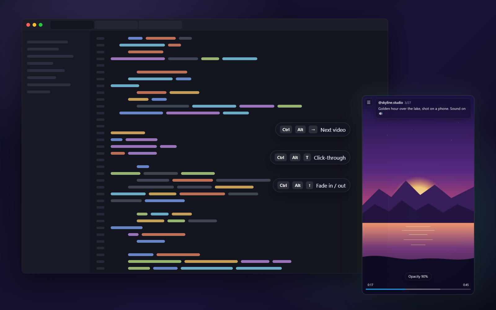
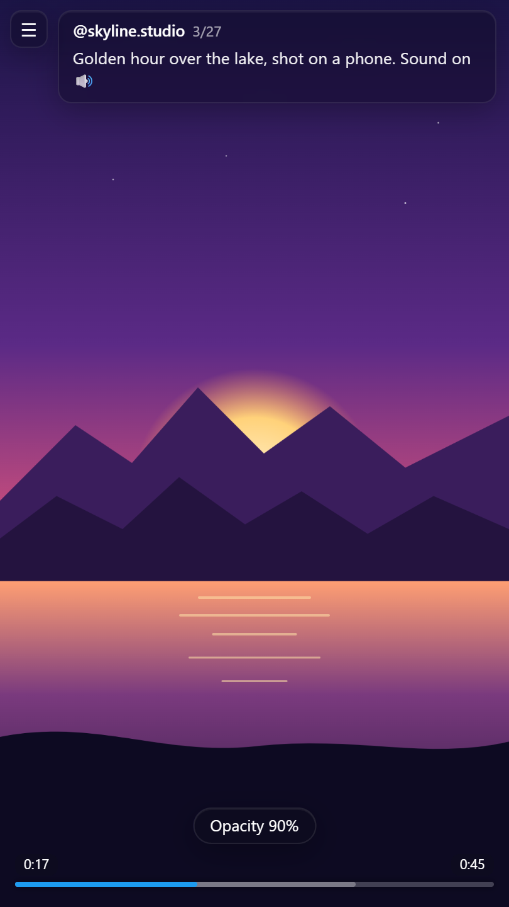
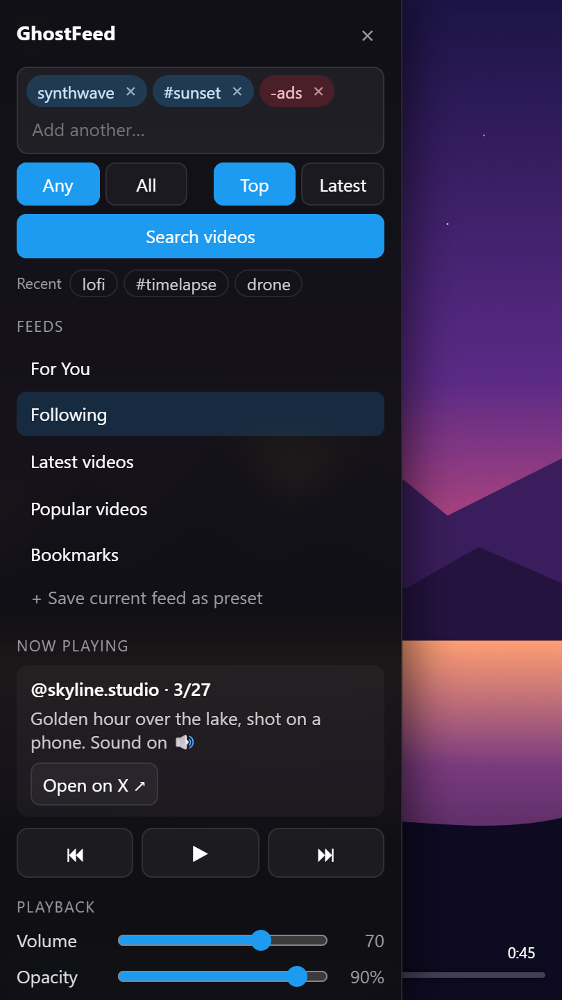

<p align="center">
  
</p>

<h1 align="center">GhostFeed</h1>

<p align="center">
  <b>Watch X (Twitter) videos as a floating, click-through overlay on Windows.</b><br>
  A borderless, always-on-top reel player with global hotkeys. Keep working while your feed plays in the corner.
</p>

<p align="center">
  <a href="https://github.com/248Tech/GhostFeed/releases/latest"></a>
  
  <a href="LICENSE"></a>
  <a href="https://248tech.github.io/GhostFeed/"></a>
</p>

<p align="center">
  
</p>

GhostFeed turns any X page into a vertical video feed that floats over your other apps. It plays videos one after another in a borderless window that stays on top. You can fade it out, make it click-through, and control it with global hotkeys without leaving the app you're working in.

It is a sibling of [GhostReel](https://github.com/248Tech/GhostReel), which does the same for local video files.

## Features

- **Always on top, borderless.** Drag to move, drag the edges to resize. Each video's shape is kept, and the window can reshape itself to fit portrait or landscape clips.
- **Click-through and opacity.** Fade the overlay from 10% to 100% and let clicks pass through to the app underneath.
- **Global hotkeys.** Next, previous, play/pause, seek, volume, opacity, mute, autoplay and more, from any app.
- **Any X feed.** For You, Following, bookmarks, a user's Media tab, or a search, plus your own saved presets.
- **Multi-tag search.** Combine words, `#hashtags`, `@accounts` and `-exclusions` with Any/All matching and Top/Latest sorting.
- **Up to 4K in fullscreen.** The window uses your quality setting. Fullscreen switches to the best version X has, without restarting the clip.
- **Instant next.** The next clip loads while the current one plays.
- **Scrub bar, fly-out menu, and readable captions** on a frosted-glass card.
- **Small.** About 1.4 MB (lite build), built on the Edge WebView2 runtime that ships with Windows 11.

<p align="center">
  
  &nbsp;&nbsp;
  
</p>

## Install

1. Download from the [latest release](https://github.com/248Tech/GhostFeed/releases/latest):

   | File | Size | Use it when |
   |---|---|---|
   | **`GhostFeed-win-x64.exe`** | ~65 MB | Recommended. Runs on any Windows 10/11 x64 PC, nothing else needed. |
   | `GhostFeed-win-x64-lite.zip` | ~1.4 MB | You already have the [.NET 8 Desktop Runtime](https://dotnet.microsoft.com/download/dotnet/8.0) (`winget install Microsoft.DotNet.DesktopRuntime.8`). |

2. Put the exe anywhere (for example `C:\Apps\GhostFeed\`) and run it. There's no installer and nothing is written outside your user profile.
3. **Windows SmartScreen** may say "Windows protected your PC" because the exe isn't code-signed. Click **More info → Run anyway**. You can check the download against `SHA256SUMS.txt` in the release: `Get-FileHash .\GhostFeed-win-x64.exe`.
4. On first launch the x.com sign-in page opens inside GhostFeed. Sign in with your account (Google, Apple and password sign-in all work). After sign-in it hides the browser and starts playing your feed.

Requirements: Windows 10 or 11 (x64) and the Microsoft Edge WebView2 Runtime, which is built into Windows 11 and installed with Edge on Windows 10 ([download](https://developer.microsoft.com/microsoft-edge/webview2/) if missing).

To uninstall, delete the exe, then remove `%APPDATA%\GhostFeed` (settings) and `%LOCALAPPDATA%\GhostFeed` (sign-in data).

## Controls

Global hotkeys work even when GhostFeed is click-through or another app has focus. You can rebind them in `settings.json` (restart to apply):

| Hotkey | Action |
|---|---|
| `Ctrl+Alt+Space` | Play / pause |
| `Ctrl+Alt+Right` / `Left` | Next / previous video |
| `Ctrl+Alt+Shift+Right` / `Left` | Seek ±5 s |
| `Ctrl+Alt+A` | Autoplay on/off (off = loop the current video) |
| `Ctrl+Alt+M` | Mute |
| `Ctrl+Alt+Shift+Up` / `Down` | Volume ±5% |
| `Ctrl+Alt+Up` / `Down` | Opacity ±5% |
| `Ctrl+Alt+T` | Click-through on/off |
| `Ctrl+Alt+H` | Hide / show (pauses while hidden) |
| `Ctrl+Alt+F` | Fullscreen on/off |
| `Ctrl+Alt+S` | Menu panel (focuses search) |
| `Ctrl+Alt+B` | Show / hide the x.com browser |
| `Ctrl+Alt+O` | Open the current post in your browser |
| `Ctrl+Alt+R` | Refresh the feed |
| `Ctrl+Alt+Q` | Quit |

When the player has focus:

| Key | Action |
|---|---|
| `S` / `/` / `Tab` | Menu panel (`Esc` closes) |
| `Space` / `K` | Play / pause |
| `N` / `J` / `PgDn` | Next |
| `P` / `PgUp` | Previous |
| `←` / `→` | Seek ±5 s (with Shift: ±15 s) |
| `↑` / `↓` | Volume |
| `F` / `F11` | Fullscreen (`Esc` exits) |
| `V` | Scrub bar on/off |
| `A` / `M` | Autoplay / mute |
| `O` / `B` / `R` | Open post / x.com browser / refresh |
| `T` / `H` | Click-through on / hide |

Mouse (when not click-through):

| Input | Action |
|---|---|
| Click | Play / pause |
| Double-click | Fullscreen |
| Drag | Move the window |
| Drag an edge or corner | Resize (hold Shift to resize freely) |
| Wheel / Ctrl + wheel | Volume / opacity |
| Scrub bar (bottom, on hover) | Click or drag to seek |
| ☰ (top-left, on hover) | Menu panel |
| Right-click | Full menu: sources, quality, opacity, always on top, … |

## Choosing what plays

- **Menu panel** (☰, `S` or `Ctrl+Alt+S`):
  - **Search:** type a word, `#hashtag`, `@user` or phrase and press Enter or comma to add it as a chip. Start a tag with `-` to exclude it.
  - **Options:** **Any** matches any tag, **All** requires every tag, and Top/Latest sets the order.
  - **Run it:** press Enter on an empty box. When you open the panel on a search, its tags are already filled in, so adding a tag widens the current search.
  - **Feeds:** pick For You, Following, Latest, Popular, Bookmarks or your saved presets.
- **Browse:** press `Ctrl+Alt+B`, go to any x.com page (a list, a profile, a community), and press `Ctrl+Alt+B` again. That page becomes the feed.
- **Command line:** `GhostFeed.exe "https://x.com/search?q=cats%20filter%3Anative_video"`.

**Quality.** The window plays the best version at or below *Quality (window)* (default 1080p). Fullscreen always uses the best version X has, up to 4K, and a clip already playing upgrades in place. You can turn this off with *Quality → Max quality in fullscreen*.

## Settings and data

| What | Where |
|---|---|
| Settings (window, hotkeys, presets, quality) | `%APPDATA%\GhostFeed\settings.json` |
| X sign-in (WebView2 profile) | `%LOCALAPPDATA%\GhostFeed\WebView2` |
| Logs (with `--verbose`) | `%APPDATA%\GhostFeed\log.txt` and `dumps\` |

GhostFeed talks only to x.com and X's video CDN, through your own signed-in session. It has no telemetry or analytics, and it doesn't save videos.

## Build from source

Requirements: Windows 10/11 and the [.NET 8 SDK](https://dotnet.microsoft.com/download/dotnet/8.0).

```powershell
git clone https://github.com/248Tech/GhostFeed
cd GhostFeed
.\build.ps1                  # dist\GhostFeed.exe (lite, needs .NET 8 Desktop Runtime)
.\build.ps1 -SelfContained   # dist\GhostFeed.exe (runs anywhere)
.\build.ps1 -Release         # dist\release\ (both builds + SHA256SUMS.txt)
```

## How it works

- **`Feeder.cs`**
  - Runs x.com in a hidden WebView2 and captures X's own timeline responses (`/i/api/graphql/*`) with `WebResourceResponseReceived`, instead of reading the page layout.
  - Scrolls the hidden page when fewer than 5 videos are queued, so X loads more.
  - Blocks the timeline's own video downloads while hidden.
- **`FeedParser.cs`**
  - Finds every `video_info.variants` block and keeps all mp4 versions, so the player can choose per mode.
  - Skips ads and HLS-only media.
- **`PlayerHost.cs` + `Assets/player.html`**
  - Two `<video>` elements: one plays while the other preloads the next clip, or a higher-quality version for fullscreen.
- **`MainForm.cs`**
  - Layered-window opacity, `WS_EX_TRANSPARENT` click-through, aspect-locked resizing, `RegisterHotKey`, menus.

**Troubleshooting.** Run `GhostFeed.exe --verbose`. It logs each captured operation and saves the latest raw response per operation to `%APPDATA%\GhostFeed\dumps\`. These are what you need to fix the parser if X changes its JSON.

## Notes

- GhostFeed is for personal viewing with your own account. It scrolls at a normal pace, doesn't download or redistribute videos, and you're responsible for following [X's Terms of Service](https://x.com/tos).
- GhostFeed and GhostReel share default hotkeys. Only the app started first gets them, so rebind one if you run both.
- Exclusive-fullscreen games draw over every window, including always-on-top ones. Use borderless or windowed mode in the game.

## License

[MIT](LICENSE) © 2026 248Tech. GhostFeed is not affiliated with, endorsed by, or sponsored by X Corp. "X" and "Twitter" are trademarks of their respective owner.
